# BeanCave — your green coffee

!!! abstract "Artisan does / TilauScope adds"
    **Artisan does** — stores the coffee as free text in each roast file. Two roasts of the same
    bag are two unrelated strings, and nothing knows how much of that bag is left.

    **TilauScope adds** — BeanCave: a record per green coffee, with an identity that every roast
    of it points back to. That identity is what makes the rest possible — stock that goes down as
    you roast, a [roast plan](the-roast-plan.md) that learns from previous roasts of *this* coffee,
    and a history you can read.

BeanCave is where a TilauScope setup begins. It opens from **TilauScope → BeanCave**, and the
first time it opens it runs the
[first-time setup wizard](getting-started.md#first-time-setup).

<!-- CAPTURE 3.1 [scene:cave_beans] — the BeanCave window on the Green Beans tab, with several beans in the list and
the three tabs (Green Beans, Roasts, Storage) visible; Roast and Plan on the bean record. -->

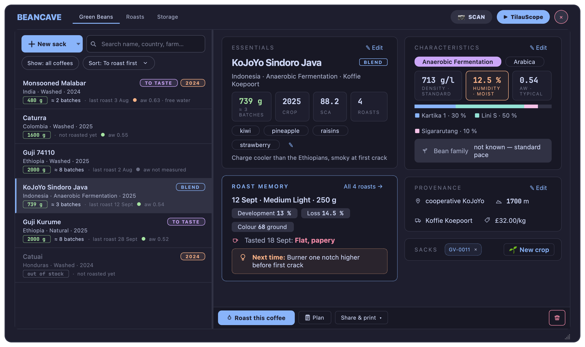

---

## The three tabs

| Tab | What it is for |
|---|---|
| **Green Beans** | The catalogue and the bean records. This chapter. |
| **Roasts** | Every roast, grouped by day and searchable, and reading one back — curve, statistics, tasting. See [After the roast](after-the-roast.md#the-roasts-tab). |
| **Storage** | How your coffee is keeping: [water activity](glossary.md#aw--water-activity), conditioning, sack labels — see [Sacks, stock and conservation](sacks-and-storage.md). |

---

## The catalogue

The Green Beans tab is where you choose what to roast. The catalogue is a readable list, not a
spreadsheet: each coffee on three compact lines — its name, its origin, then what decides the
next roast.

**Search** — *Search name, country, farm…* filters as you type.

**Show** — *Show: in stock* narrows the list to what you can actually roast today; *Show: all
coffees* brings the rest back. A coffee you have finished stays in the database, with its history
intact: out-of-stock coffees always sit at the bottom of the list, and while only the stock is
shown they fold behind one line, *Out of stock · 6 coffees*, which brings them back.

**Sort** — *Sort: To roast first* puts on top the coffee that keeps worst: a
[water activity](glossary.md#aw--water-activity) flagged as a storage risk first, then the oldest
harvest, then the coffee left longest since its last roast — a coffee never roasted comes before
any. *Sort: Name* lists them alphabetically. Both choices are remembered.

When BeanCave opens, or when you come back to it, it selects the coffee loaded in TilauScope for
the current roast, if that coffee is in the catalogue. Otherwise the record shows the first
coffee of the list as filtered and sorted. If none matches, the record is empty.

**Double-click** a coffee to open the **Roasts** tab narrowed to its roasts. A single click only
selects it: the Roasts tab keeps whatever it was showing.

Each entry's third line reads the stock in grams and in **batches** — *≈ 2 batches*, at the weight
of the coffee's last roast — then when it was last roasted, or *not roasted yet*, and a dot for its
water activity: green when typical, amber or red when it sits outside the usual range, with the
word that says why, grey when it was never measured. Badges answer the remaining questions:
**TO TASTE** when the last roast has rested past its degassing and has not been tasted yet,
**BLEND**, and the year of a harvest two or more years old — *Harvest is 2 years old*.

!!! note
    An empty list after filtering says so — *No bean matches the current filter.* — rather than
    looking like an empty database.

<!-- CAPTURE 3.2 [scene:cave_catalogue] — the catalogue with a search typed in, narrowed to the matching coffees. CAPTURE 3.3 [scene:cave_badges] — the catalogue rows, cropped, so the badges are legible: blend, old harvest, to taste, out of stock. -->

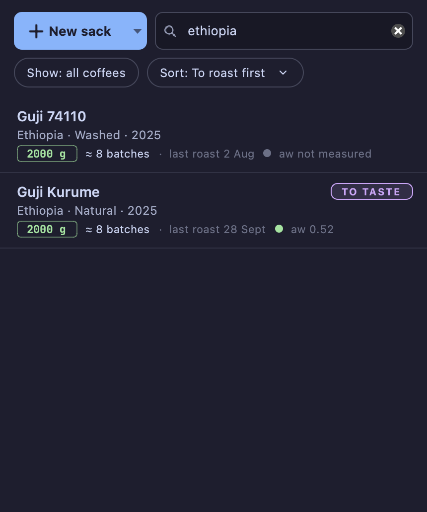

If the library's file cannot be read when BeanCave opens — damaged, or not readable on this
computer — BeanCave says so and saves nothing over it until it is repaired or restored and
BeanCave reopened. Adding a coffee to an empty catalogue at that moment would otherwise replace
every coffee on file with that one. A folder that holds no library yet — the case of a first use —
simply opens on an empty catalogue.

---

## The bean record

A record opens **to be read**, not to be edited. It is laid out in two columns that fit whole
in a small window, and **each zone has its own ✎ Edit dialog** — so correcting an altitude does
not mean re-opening a form with forty fields in it. On a taller window the sheet spreads out
rather than leaving its zones cramped at the top.

| Zone | What it holds |
|---|---|
| **Essentials** | Name, origin, process and supplier; stock (with the batches it still makes), crop year, [SCA](glossary.md#sca-score) score and number of roasts as tiles; the flavour notes and the roasting memo. Hovering the stock shows what it is worth once a price is entered. The ✎ beside the flavour notes edits the score, the notes and the memo. |
| **Roast memory** | The coffee's last roast — see [below](#the-roast-history-of-a-coffee). |
| **Characteristics** | Process, species, varieties and [screen size](glossary.md#screen-size); [density](glossary.md#density), [humidity](glossary.md#moisture-content) and water activity as tiles with their meaning; a blend's components as one bar; the [bean family](glossary.md#bean-family) and what it does to the pace of the roast. |
| **Provenance** | Farm, altitude, supplier, purchase price. |
| **Sacks** | The labels of this coffee's bags, when it has any, and **🌱 New crop** — see [Sacks, stock and conservation](sacks-and-storage.md). |

Under the record, **Roast this coffee** opens the [roast setup sheet](preparing-a-roast.md) for
it, and **Plan** opens the same sheet on its PLAN tab, to see — and compare — what a batch of it
would look like before roasting it. **Share & print** holds the bean label, its QR code and the
shareable card; the bin at the far end deletes the record, after asking, and gives its sack
labels back to the pool.

Each zone's edit button states what it covers — *Edit name, origin, year and stock*, *Edit farm,
supplier, altitude and price* — so there is no guessing which dialog holds which field. Editing a zone
changes **only** that zone: *Only this section is changed. Save writes the record immediately.*

<!-- CAPTURE 3.4 [scene:cave_record] — a complete bean record on a blend that has been roasted and tasted, with a price, a screen size and a sack: both columns visible, Roast memory showing its Next time line. -->

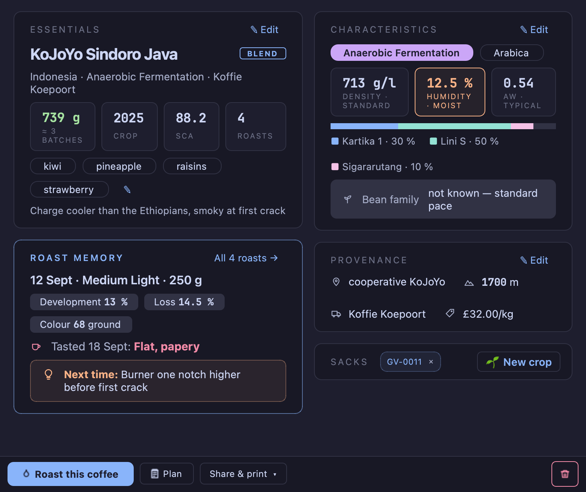

### Weighing and measuring from the record

**Stock** accepts a live weight: with a scale configured, clicking the ⚖ reading captures the
exact figure instead of a typed approximation — *With a scale configured, click the ⚖ reading to
capture the exact weight.*

**Density** can be measured the same way, from a fixed-volume container, with **Measure**. If no
scale is set up, the dialog says so plainly — *No scale configured* — rather than offering a
button that does nothing.

An unmeasured density now reads *not measured*, and the roast plan leaves the coffee's structure
alone rather than treating the empty field as a very light bean. Records saved before this
change carried 500 g/l for "empty"; they are cleared the first time the cave is opened, so a
coffee whose density you did measure at that figure needs entering again.

**Water activity** can be measured directly from the record with an AquaGauge. What the value
means for storage is in [Sacks, stock and conservation](sacks-and-storage.md).

**Density**, **Humidity** and **Water activity** each read back what the figure means, in plain
words, right after the value: *790 g/l (dense)*, *12.4 % (moist)*, *0.54 (typical)*. It appears
both in the *Characteristics* zone of the record and in the fields you edit. The comment turns
amber when the value sits outside the usual range, and red when a water activity is high enough
to be a storage risk. The bands are the same ones the roast plan and the coach's advice use, so a
value never reads *normal* in one place and is flagged in the other. An unmeasured value says
nothing.

**Flavour notes** are entered on the flavour wheel rather than typed as free text, which keeps the
vocabulary consistent from one coffee to the next.

### Price and screen size

**Price** is what the green coffee cost per kg, in the currency chosen in
[Configuration](configuration.md#-beancave--files-and-currency). Once it is entered, hovering the
stock on the record shows what the remaining stock is worth, and each roast of this coffee shows what its green cost
— see [After the roast](after-the-roast.md). Leave it at 0 if you do not know it; nothing else
depends on it.

**Screen size** is picked from a short list — *Large — AA, Supremo, 17/18+*, *Medium — AB,
Excelso, 15/16*, *Small — 14/15 and below*, *Peaberry — PB* — using whatever the supplier's
sheet states. Leave it on *Unknown* when the sheet says nothing. When a roast of this coffee is
prepared, the size is written into the roast's properties, so it stays with the roast file. It
does not change the roast plan.

!!! info "Hardware"
    Live weighing needs a [Bluetooth scale](hardware.md#bluetooth-scale); density measurement needs a scale configured as scale 1 in
    Artisan; water activity needs an AquaGauge. Everything else on the record is typed.

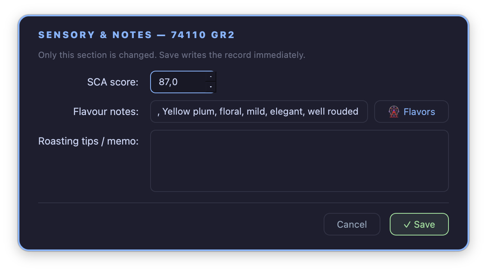

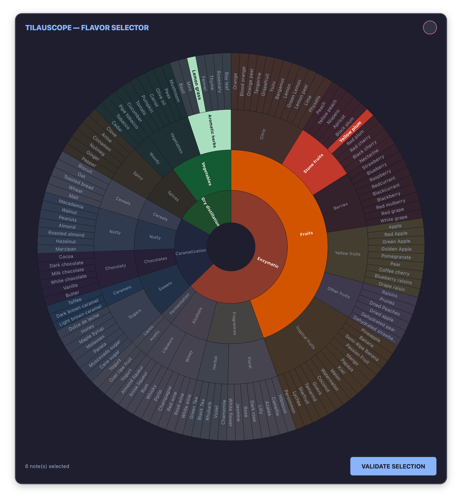

---

## Adding a coffee

**Add — expert form**, in the menu of the **+ New bean** button at the top of the catalogue,
asks how you want to start: **From current fields**, which pre-fills from what
you have already typed, or **Blank bean**, which starts fresh. A full expert form follows, with
required fields named up front — *Fill the required fields (\*): name, country, category, process,
species, varieties* — and the reassurance that matters when a bag has just arrived: *Fill what you
know — everything can be refined later from the sheet.*

**Blends** are declared as such, with their components and ratios.

Origins, processes, varieties and blend components are picked from fixed lists, the same in
every editor. A process, variety or component the list does not carry — one typed freely in an
older record, or read from a supplier's page — is shown and saved as **Other**.

!!! tip "The guided way in"
    For a bag that has just arrived, a click on **+ New bean** itself is the better route: it opens
    the **New sack** assistant, which walks through registering a new coffee, restocking an existing one, or opening a new crop year, and
    reviews everything before saving. The expert form exists for when you know exactly what you
    are entering. See [Sacks, stock and conservation](sacks-and-storage.md) for the assistant in
    full.

    When the coffee is already in the catalogue and this is simply its next harvest, select it and
    use **🌱 New crop**, on the Sacks line of its record, instead: it inherits everything that does not change and asks only for the
    new year, the weight, the price and the measurements of the lot.

### Filling a record from the supplier's page

Rather than copying a dozen fields by hand, paste the supplier's URL — *Enter URL of supplier
here...* — and TilauScope fills the record from that page, blends, component ratios and screen
size included. The price is never filled in: a shop page often prices a 250 g bag, sometimes in
another currency, so it is left for you to enter.
The result is presented for review before anything is saved.

!!! note
    This needs an AI provider configured — see [Configuration](configuration.md#-integrations--outside-services).
    Extraction reads a web page written for humans, so **check the result**: it is a first draft
    to correct, not an authority.

The link is cleaned before it is used. Shops append a great deal to an address — campaign tags,
click identifiers, and sometimes a customer, order or session reference tying the page to you —
and all of that is removed: what is fetched and sent for extraction is the product page itself.
Paste the link as you copied it; there is nothing to tidy up by hand.

Only a public supplier page can be read. An address on your own network, or a link that is not
http or https, is refused with a message rather than fetched — that page would be handed to an
outside service, and nothing on your network belongs there. A link that looks public but leads to
your own network, by a redirection or by the name it points to, is refused on the same grounds.

The first time a supplier page is sent to a given AI provider, TilauScope names that provider and
says what the request carries before anything leaves — see [Configuration](configuration.md#privacy).

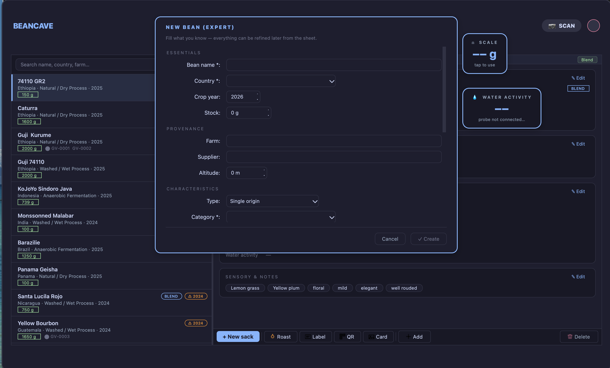

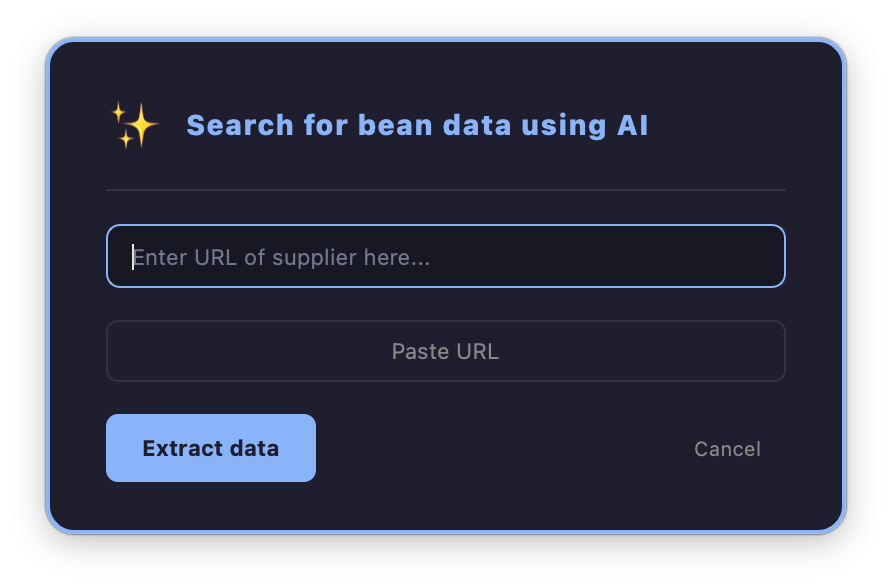

---

## The roast history of a coffee

The **Roast memory** zone recalls the coffee's last roast: its date, the
level it ran at — read from how long it developed and how hot it was
dropped, not from its colour — and its weight, then its development, weight loss and colour.
What follows depends on where that roast stands:

- **Not roasted yet** — the first plan starts from the coffee's characteristics.
- **Rested, not tasted** — *Rested 6 days — how did it taste?* with **Taste…**, which opens the
  [tasting](after-the-roast.md#tasting) of that roast.
- **Tasted** — what was tasted, for example *Tasted 18 Sep: Flat, papery*, and the one change the
  next roast makes: *Next time: Burner one notch higher before first crack*.

When the coffee has a [reference roast](glossary.md#reference-roast), the zone opens on
**NEXT PLAN**: the ★ reference, its date and batch number, the level it ran at, its weight, and
its development, weight loss and colour. The last roast follows under **LAST ROAST**, with its
tasting — and with its own development, weight loss and colour whenever the reference is not
used. **NEXT PLAN** also says when the reference is not used, and why — *not used, tasted
Almost since*, *not used, excluded from learning*, or that its roast file was not found while the
roast folder cannot be reached — and turns orange when *the last roast followed it and was off*: the coffee may have changed. A new
harvest without roasts of its own shows the previous harvest's reference it starts from, for
example *★ 2025 crop · #31*. To mark a reference, see
[Marking the reference roast](after-the-roast.md#marking-the-reference-roast).

<!-- CAPTURE 3.10 [scene:cave_reference_memory] — Roast memory on a coffee with a reference roast: NEXT PLAN in its yellow
frame (★ date · batch, level · weight, development, loss and colour), then LAST ROAST with its
tasting line. -->

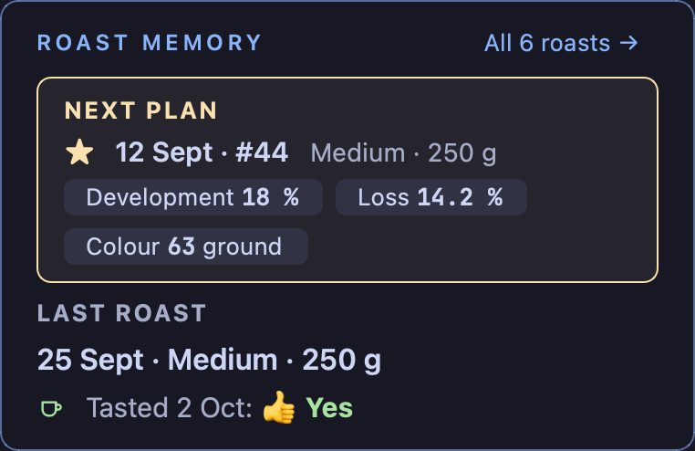

**All 4 roasts →** opens the **Roasts** tab narrowed to this coffee — curve, key events,
statistics and tasting; see [After the roast](after-the-roast.md) for what it shows. This is the
same history the [roast plan](the-roast-plan.md#what-the-plan-learns-and-when) learns from,
which is why keeping records attached to the right coffee matters: a roast filed against the
wrong bag teaches the plan the wrong lesson.

---

## Sharing and printing

A bean record can be exported as a **landscape image sized for social networks**, and so can a
roast — green coffee, roast level, key figures and the curve on one card (see
[After the roast](after-the-roast.md#sharing-a-roast) for the roast card).

Labels for beans, roasts and sacks print from here — a bean's from **Share & print** on its
record — each carrying a QR code that opens the
corresponding record. The **📷 SCAN** button reads those codes with the webcam; a phone camera
works too — see [Labels and QR](labels-and-qr.md) for printing and scanning in full.

!!! note
    Printing and scanning are optional throughout. A setup that never prints a label never sees a
    prompt about one.

---

## Sharing a coffee

A coffee can travel as one file, ending in `.tilaucoffee`: to another roaster who roasts the same
coffee, or to your own other computer. **Share & print › Share this coffee…** on its record opens
the window, and two tabs choose who it is for.

**With another roaster** packs a starting point: the coffee's record without its stock, bags or
price, its [reference roast](glossary.md#reference-roast), your tasting of that roast and your
brewing settings. Without a reference roast the package carries the record and the brewing
settings only: mark the roast you would roast again with a ★ to include it — see
[Marking the reference roast](after-the-roast.md#marking-the-reference-roast). The roast is
cleaned before it leaves: your name and organisation, the room's temperature, humidity and
pressure, and every folder path, computer name or identifier written into the file are removed,
including from your notes. The coffee's supplier stays.

**To another of my computers** packs the coffee as it is here: the record with stock, bags and
price, every roast of it, their tastings, the brewing settings and the brewing journal. Nothing is
removed, and nothing is deleted from this computer.

**Save package…** writes the file, by default in your Downloads folder; **Show in folder** then
finds it for sending.

<!-- CAPTURE 3.11 [scene:coffee_share] — the Share this coffee window on With another roaster: IN THE PACKAGE
listing the record without stock, bags or price, the ★ reference roast and its tasting, and the brewing settings; the
note on what is left out of the roast. -->

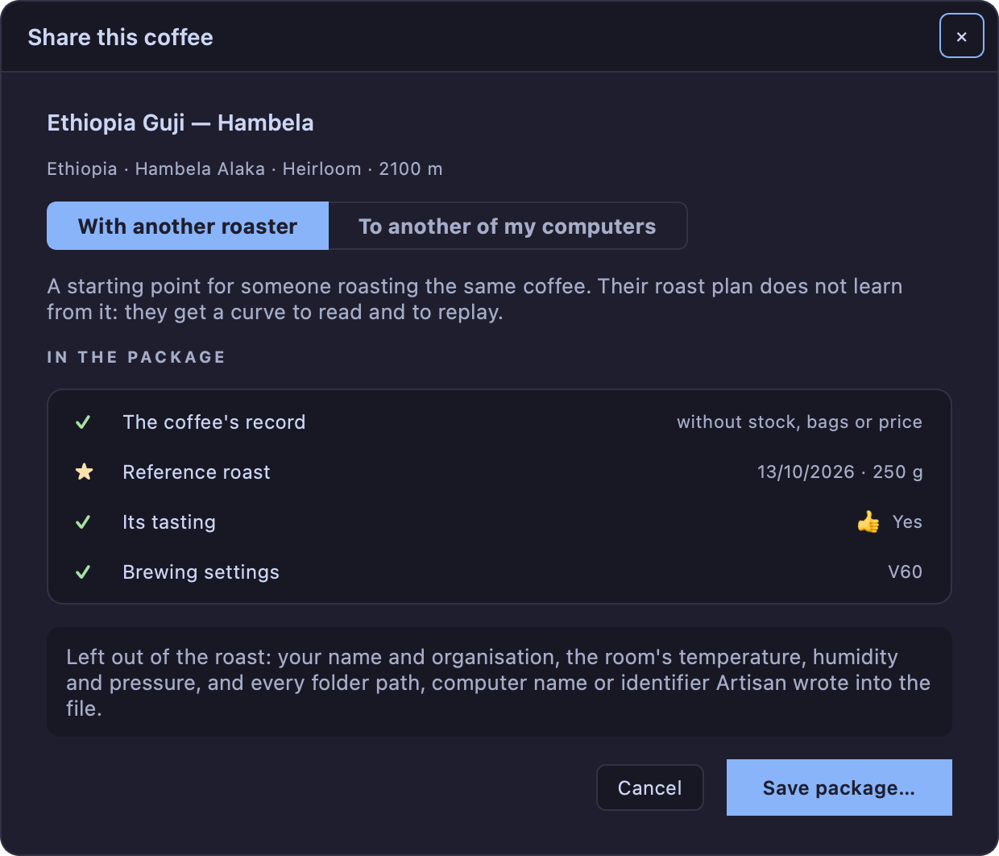

### Importing a coffee

**+ New bean ▾ › Import a coffee…** opens a `.tilaucoffee` file and shows what it brings before
anything changes: who it comes from, the date and the TilauScope version it was made with, then
**WHAT YOU GET**. On an empty BeanCave the **New bean** button sits under the empty-cellar message.

- **The coffee is new here** — its record joins the catalogue.
- **The coffee is already here** — from another roaster, your record stays as it is and their
  roast joins it. From your other computer, the roasts you do not have yet are added and nothing
  is deleted or overwritten; tick **Replace my record of this coffee** to take that computer's
  record.
- **Every roast is already here** — the window says so, and **Import** stays unavailable: there is
  nothing to add. From your other computer, ticking **Replace my record of this coffee** makes it
  available again.
- **Roasted on another machine** — a warning names that machine: the curve is one to read, not
  to copy.

A file made by a newer TilauScope, or a damaged one, is refused and nothing changes.

<!-- CAPTURE 3.12 [scene:coffee_import] — the Import coffee window for a coffee shared by another roaster: the origin
line, WHAT YOU GET with their reference roast, their tasting and their brewing settings, and the caption on shared
roasts. -->

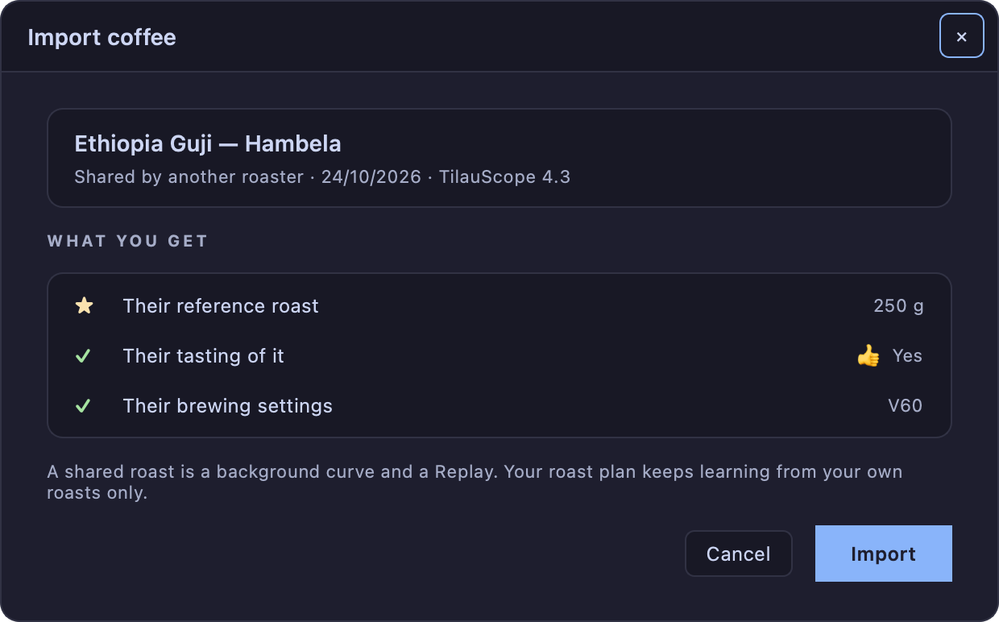

### What a shared roast is

A roast that came from another roaster is a [shared roast](glossary.md#shared-roast). It is
listed in **Roasts** with a **Shared** badge, and it opens, reads and compares like any other
roast. To roast along with it, select it and use **Background** at the top of the roast: it
becomes the background curve of your next roast, which [Roast Replay](glossary.md#roast-replay)
can follow.

Its tasting line shows the sender's verdict as theirs — *Their tasting: Almost* — to read, not to
edit: it is their cup, not yours. A shared roast that came without a tasting says so, and never
asks you how it tasted.

Your roast plan does not learn from it until you choose to. A line above its figures says so,
with **Learn from this roast**: once a roast suits you — after replaying it, typically — that
button lets the plan learn from it like one of your own roasts. Its badge then reads
**Shared · learning**, and it can be marked as the coffee's
[reference roast](glossary.md#reference-roast) without a tasting of yours: you cannot taste the
sender's cup, so choosing to learn from it stands for your *Yes*. **Stop learning from this
roast** takes it back out; if it is the reference, a confirmation removes the ★ first.

Some things never change, learned from or not: it is never the coffee's last roast on its
record, the sender's tasting never sets the *Next time* change, and it takes nothing from your
stock, roast count or roasted weight — it was roasted elsewhere.

<!-- CAPTURE 3.13 [scene:cave_shared_learning] — the Roasts tab on a shared roast the plan learns from: the Shared · learning badge on its row, the
line above its figures with Stop learning from this roast, and the ★ on its tasting line. -->

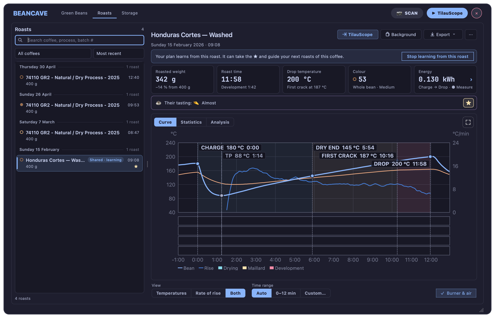

A roast made on another machine is not learned from at all: the line says *Roasted on a
Skywalker V1. Replay it on your roaster: the roast you make will teach your plan.* Follow it on
your own machine; the roast you make is yours, and that one teaches the plan.

Roasts brought from your own other computer are not shared roasts: they count as yours.

---

## Roast files

Auditing incomplete roast files, linking one to a green coffee, and recomputing how many roasts
each coffee has is not a BeanCave tab — it opens from **TilauScope → Roast Profile
Maintenance…**. See [Repairing incomplete roast files](after-the-roast.md#repairing-incomplete-roast-files).

---

## Next

- What to configure so all of this works: see [Configuration](configuration.md).
- Tracking bags and keeping condition: see [Sacks, stock and conservation](sacks-and-storage.md).
- Printing and scanning labels: see [Labels and QR](labels-and-qr.md).
- Generating a plan for a coffee: see [The roast plan](the-roast-plan.md).
- Roasting it: see [Preparing a roast](preparing-a-roast.md).
